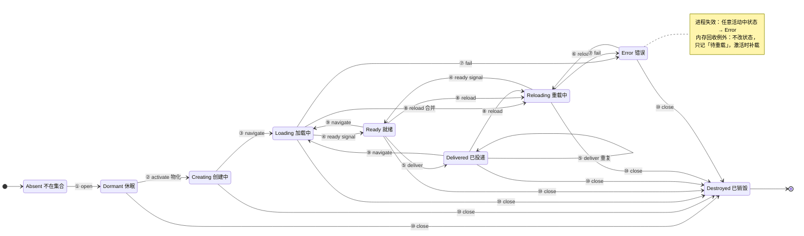

# 页面设计（views-design.md · UI · 结构 · 状态 · 交互）

> 定位：WorkStudio 的 **Electron 集成设计**——窗口、布局、壳层、原生视图、页面托管、交互与视觉；以及本域对 agent 的依赖面（§1.5）。
>
> 依赖关系：`views → agent → pi` 单向。架构前提（分层、依赖方向、状态归属、通讯、平台事实）见 [`architecture.md`](./architecture.md)；资源管道、页面解析与页面会话契约见 [`agent-design.md`](./agent-design.md)。

## 一、页面结构总览

### 1.1 形态

应用是**单一工作台窗口 + 系统视图**：壳层由 DOM 承载，标签内容一律由原生视图承载。

```
┌─ S1 TitleBar  h=40 ──────────────────────────────────────────────────────────────────────────────────────────────────────────────────┐
│ <- Workspace Selector · Sidebar Toggle      │<-       Address Capsule: URL + Toolbar       ->│        Actions: Chat / Theme / User ->│
├─ S2 Sidebar ────────────────────────────────┬─ S3 Resource Panel ────────────────────────────┬─ S4 Assistant (floatable) ────────────┤
│ Catalog Tabs: Resources | Plugins | Settings│ Resource Tabs: [DocA * x] [DocB x] [Web x]  < >│   Session Tabs:  Chat 1 | Float | New │
│─────────────────────────────────────────────│────────────────────────────────────────────────│───────────────────────────────────────│
│ |-- Group rows                              │ ┌────────────────────────────────────────────┐ │ ┌───────────────────────────────────┐ │
│ |    `-- Sub list                           │ │Content area = native view                  │ │ │Message stream                     │ │
│ `-- Expanded items                          │ │Doc renderer / Plugin settings / Web page   │ │ │User bubble                        │ │
│                                             │ │native WebContentsView                      │ │ │Thinking / Text / Tools            │ │
│                                             │ │DOM paints empty state only                 │ │ │Input card                         │ │
│                                             │ │                                            │ │ │Mode / Model / Send                │ │
│ <- 15%~30% ->                               │ └────────────────────────────────────────────┘ │ └───────────────────────────────────┘ │
└─────────────────────────────────────────────┴────────────────────────────────────────────────┴───────────────────────────────────────┘
 S5 Overlays (over content area) - pointer capture layer (during interaction)

图例：
  Workspace Selector 工作区选择器 · Sidebar Toggle 侧栏开关 · Address Capsule 地址栏胶囊 · Actions 动作组
  Catalog Tabs 文档目录 · Resource Tabs 资源标签栏 · Session Tabs 会话标签行
  S2 Sidebar 侧栏 · S3 Resource Panel 资源面板 · S4 Assistant AI 助手
  Overlays 浮层 · Pointer Capture Layer 指针捕获层
```

两条结构性需求（其余章节都是它们的展开）：

1. **内容与壳层分离**：一切「标签内容」（文档渲染器、插件设置页、网页）都在独立进程表面里，壳层不复制它们的 UI，也不假设能遮盖它们。
2. **打开集合唯一**：任何「打开」都产生资源面板的一个标签；不存在第二套打开通道（新窗口、独立弹窗一律收编）。

### 1.2 区域解剖

**S1 TitleBar 四部件三区**——功能上拆成四个部件，布局上归为三个区：

| 部件 | 名称         | 布局区         | 内容与职责                                                                                                                       |
| ---- | ------------ | -------------- | -------------------------------------------------------------------------------------------------------------------------------- |
| ①    | 工作区选择器 | 左区           | 当前工作区名 / 绝对路径；选择目录、在系统中打开（下拉走原生菜单）                                                                |
| ②    | 侧栏开关     | 左区           | 侧栏收起 / 展开                                                                                                                  |
| ③    | 地址栏胶囊   | 中区（拖拽区） | 激活视图的整枚投影：类型图标 / 逻辑地址 / 加载指示 / 内部工具条（贴胶囊右侧，可多个按钮，各带激活 / 禁用态）；无激活视图时不渲染 |
| ④    | 动作组       | 右区           | 助手开关 / 主题切换 / 应用标识                                                                                                   |

**S3 标签项解剖**（高 36px、左右内距 20px、标题居中）：

```
┌───────────────────────────────┐      激活：与内容区同底色 + 顶部 1px 靛蓝高亮
│ ▣  标题（≤128px 截断）  ●  ×  │      非激活：弱底色；hover 提亮
└───────────────────────────────┘      固定：标题前 Pin 图标，无关闭钮
   ↑类型图标      ↑脏点 / 错误标   ↑关闭钮（hover 出现）
   拖动：被拖项半透明 + 插入位 1px 靛蓝竖线；溢出：左右箭头，每次滚动 180px
```

**S3 内容区与分隔条**：DOM 只画空态（居中图标 + 一句引导），原生视图矩形覆盖其上；分隔条是 6px 让位带——两侧各取邻栏表面色（中点分界）+ 居中 1px 分界线。

**S2 侧栏三层**：顶部导航（资源 / 插件 / 设置；收起态 = 单按钮 + 原生菜单）→ 形态内容（分组行 / 二级列表 / 插件列表 / 设置列表）→ 展开项（已打开条目的聚拢区）。

**S4 助手三块**：会话标签行（浮动态整排即标题栏，可拖拽）· 消息流 · 输入卡片（卡片上方另有 token 状态行）。

**S5 系统视图两类**：浮层（覆盖内容区的透明模态）· 指针捕获层（交互期出现的透明全工作台指针层，只发信号）。

### 1.3 部分清单

| 编号 | 部分         | 职责一句话                                                     | 归属状态域      |
| ---- | ------------ | -------------------------------------------------------------- | --------------- |
| S1   | TitleBar     | 工作区切换、侧栏开关、地址栏与按类型动作、助手开关、主题、标识 | 壳层            |
| S2   | 侧栏         | 资源 / 会话 / 插件 / 设置四种形态的浏览与导航                  | 侧栏形态态      |
| S3   | 资源面板     | 打开集合的标签管理 + 内容区（原生视图承载）                    | 视图集合域      |
| S4   | AI 助手      | 会话标签、消息流、输入区与档位 / 模型选择                      | 会话域 + 输入域 |
| S5   | 浮层与捕获层 | 模态与扩展 UI 对话框；交互期的指针入口                         | 瞬态            |

### 1.4 承载总表

| 区域                                         | 承载     | 说明                                         |
| -------------------------------------------- | -------- | -------------------------------------------- |
| S1 标题栏 · S2 侧栏 · 标签栏 · 空态 · 分隔条 | DOM      | 无原生视图覆盖；下拉、hover 卡片可自由实现   |
| S3 内容区                                    | 原生视图 | 文档渲染器 / 插件设置页 / 网页；DOM 只画空态 |
| S4 助手                                      | 原生视图 | 页面内部自绘（消息流 / 输入区 / 选择器）     |
| S5 浮层 / 捕获层                             | 原生视图 | 浮层透明；捕获层常驻预热                     |

### 1.5 与 agent 的分工（依赖面）

本域只做 Electron 集成：窗口、布局、原生视图、页面托管。资源语义、格式、版本、写队列、结构化数据都在 agent 层。

```
pi（内核）
   ▲ 官方扩展点
agent 层：pi 接入（资源轴 / 注册轴）+ 资源管道（URA）+ harness + 视图宿主
   ▲ 页面解析 · 页面会话 · 变更订阅 · 命令
views 层：窗口 · 布局 · 原生视图 · 页面 · 壳层
```

| 本域需要                                    | agent 提供                           | 本域不碰                   |
| ------------------------------------------- | ------------------------------------ | -------------------------- |
| 打开文档时用哪个页面、入口地址、声明动作    | 页面解析（文档类型 / 扩展名 → 页面） | 格式识别、编解码、来源访问 |
| 页面投递、外部变更、保存 / 提交、冲突       | 页面会话契约                         | 版本号、写队列、结构化数据 |
| 资源列表、分组、打开集合、会话列表          | 命令（资源域 / 会话域）              | 直接读写文件或网络         |
| 页面拿到的内容形态（文档 / 可编辑数据投影） | 门面可见性策略                       | 数据轨判定规则             |
| 主题、布局、交互、视觉                      | —（本域自持）                        | —                          |

规则：

- **反方向只有意图**：打开 / 提交 / 订阅 / 命令，不携带资源内容。
- **页面只声明入口与桥协议**：不持有视图句柄，不直接触达 agent 内部。
- **本域不 import pi**，也不依赖管道实现；agent 的契约面变化是唯一需要跟随的接口。

## 二、领域实体字典

先立实体，后立状态——壳层与视图状态都是这几类实体的投影。**文档与页面匹配属于 agent 层**，本域只持引用与运行期形态。

| 实体           | 字段                                                                                                                                       | 说明                                                             |
| -------------- | ------------------------------------------------------------------------------------------------------------------------------------------ | ---------------------------------------------------------------- |
| **视图实例**   | 稳定键 · 类型（页面 / 网页） · 标题 · 逻辑地址 · 页面标识 · 状态 · 激活位 · 固定位 · 脏态 · 临时标记 · 可交互元素开关 · 声明动作与动作状态 | 一个标签 = 一个实例；同稳定键复用实例，绝不重复打开              |
| **文档引用**   | 标识 · 展示标题 · 定位地址 · 扩展名 · 分组 · 来源（内容轨与渲染器归 agent）                                                                | 打开时由 agent 解析出页面；本域只用引用，不判格式、不判内容轨    |
| **会话**       | 路径（唯一键） · 标题 · 预览 · 创建时间 · 消息流 · token 统计                                                                              | 消息流按会话隔离加载；标题与预览由首条用户消息与末条助手消息派生 |
| **页面贡献**   | 入口地址 · 匹配键（文档类型 / 扩展名 / 设置标识） · 声明动作 · 可访问资源白名单                                                            | 由 agent 装配并解析；本域只消费解析结果，不自建页面清单          |
| **工作区现场** | 主题 · 侧栏形态 · 侧栏收起 · 栏宽 · 助手形态与开关 · 工作区 · 输入区展开                                                                   | 按工作区持久化，重启恢复现场                                     |
| **交互态**     | 会话类型 · 目标 · 方向 · 锚点 · 预览几何                                                                                                   | 瞬时；只在指针按下期间存在                                       |

关键语义：

- **稳定键**是持久化的唯一依据（视图实例的运行期句柄重建即失效）。
- **逻辑地址**面向用户（文档 = 工作区相对路径或原始 URL；页面 = 应用地址；网页 = 原始 URL）；页面的物理文件位置不出现在界面。
- **页面解析归 agent**：用哪个页面、入口地址、声明动作、可投递内容都由 agent 解析；本域不做格式判断，也不持版本与队列。
- **会话标签与视图标签是两套集合**：会话标签关掉不删数据，视图标签关掉即销毁时内容；两者不共享命令域。

## 三、S1 TitleBar

### 3.1 职责与构成

```
┌─ 左区 ──────────────────────────┐ ┌─ 中区（拖拽区） ───────────────────────────┐ ┌─ 右区 ──────────┐
│ ① 工作区选择器 ▾ · ② 侧栏开关 ▤ │ │ ③ 地址栏胶囊 ▣ 逻辑地址 ⟳ │ 内部工具条 ▣▣▣ │ │ ④ 动作组 💬 ☀ W │
└─────────────────────────────────┘ └────────────────────────────────────────────┘ └─────────────────┘
```

**③ 地址栏胶囊内部**（全圆角；内部工具条贴胶囊右侧，可容纳多个按钮）：

```
╭──────────────────────────────────────────────────────────────────────╮
│ ▣  逻辑地址（等宽、截断）                                ⟳  │  ▣ ▣ ▣ │
╰──────────────────────────────────────────────────────────────────────╯
 ↑类型图标                                                 ↑加载指示
                                                                 ↑内部工具条（按类型动作，可多个；态随激活文档）
```

- 左区 · ① 工作区选择器：当前工作区名 / 绝对路径；选择目录、在系统中打开。
- 左区 · ② 侧栏开关：侧栏收起 / 展开。
- 中区（拖拽区）· ③ 地址栏胶囊：整枚随激活文档收敛——类型图标 / 逻辑地址 / 加载指示 + **内部工具条**（贴胶囊右侧；按钮集合可多个，各按钮带激活 / 禁用态）；无激活视图时不渲染。
- 右区 · ④ 动作组：助手开关 / 主题切换 / 应用标识；打开态一律以**图标本体高亮**表示（非背景块）。
- 整条为窗口拖拽区；按钮与地址栏胶囊为可交互区。

### 3.2 状态

| 状态       | 取值               | 初始     | 持久化 | 说明                                   |
| ---------- | ------------------ | -------- | ------ | -------------------------------------- |
| 主题       | 亮 / 暗            | 暗       | ✅     | 全局唯一来源，经原生主题层收敛         |
| 助手开关   | 布尔               | 开       | ✅     | 右栏是否显示                           |
| 侧栏收起   | 布尔               | 否       | ✅     | 收起为固定宽图标列                     |
| 侧栏形态   | 资源 / 插件 / 设置 | 资源     | ✅     | 由 S2 承担切换                         |
| 工作区     | 路径               | 最近打开 | ✅     | 切换即换代                             |
| 地址栏胶囊 | —                  | —        | —      | 无自有状态；整枚由激活文档投影（§5.5） |

### 3.3 操作与状态变迁

| 操作            | 触发             | 状态变迁     | 跨部分联动                                                 |
| --------------- | ---------------- | ------------ | ---------------------------------------------------------- |
| 收起 / 展开侧栏 | ② 侧栏开关       | 侧栏收起取反 | 侧栏切图标列 / 完整列表；宽度不再可拖                      |
| 选择工作区      | ① 工作区选择器   | 工作区换代   | 资源列表重扫、会话目录切换、打开集合失效清理、地址前缀全变 |
| 切换助手        | ④ 动作组 💬      | 助手开关取反 | 助手视图显示 / 隐藏（页面状态保留）                        |
| 切换主题        | ④ 动作组 ☀ / 🌙  | 主题取反     | 全局变量 + 原生控件 + 全部页面 + 窗口底色同步（§3.5）      |
| 地址栏动作      | ③ 内部工具条按钮 | 依动作语义   | 经命令下发到对应视图（§5.6）                               |
| 重载激活标签    | 菜单 / 快捷键    | —            | 只重载内容视图，不重载壳层                                 |

### 3.4 规则

- **窗口控制留白不写死**：三键 / 红绿灯的位置与尺寸由平台决定（macOS 在左，Windows 覆盖层在右，Linux 视桌面环境）。适配先判平台，再按运行时实测矩形反推两侧留白；标题栏高度与覆盖层同源，主题切换时同步覆盖层配色。
- 工作区下拉必须走**原生菜单**（跨内容面的 DOM 弹层必被原生视图遮挡）。
- 左区的两个部件（① 工作区选择器 / ② 侧栏开关）同属一个布局分组，内部次序不承载语义（可互换）。
- 侧栏三形态的切换入口在 S2 顶部导航，不在标题栏重复。
- 地址栏的加载指示只在此处出现（内容区不重复表达加载态）。
- 资源的按类型动作一律渲染进地址栏胶囊的内部工具条（贴胶囊右侧排列，可容纳多个按钮），不另设胶囊外动作位。

### 3.5 主题传播链（全局亮暗收敛的唯一入口）

真相源在主进程用户状态；启动 / 切换 / 工作区挂载时收敛到系统主题层，之后一切亮暗派生自原生层：

| 消费方                 | 机制                                   | 说明                                                     |
| ---------------------- | -------------------------------------- | -------------------------------------------------------- |
| 壳层与助手页           | 状态镜像 + 根元素主题类                | 应用自身 UI                                              |
| 插件页                 | 视图总线主题广播（就绪时主动补发）     | 页面以根属性 + `color-scheme` 承接（控件与滚动条配色）   |
| 网页                   | 系统主题 → 页面 `prefers-color-scheme` | 已适配亮暗的站点自动跟随；未适配的原样渲染（不强制变暗） |
| 原生控件（右键菜单等） | 系统主题层                             | 原生 UI 自动配色，无需传参                               |
| 窗口控制覆盖层         | 随主题写入覆盖层配色                   | 不同步会留下与标题栏脱节的色块                           |
| 内容视图底色           | 随主题更新视图底色                     | 加载期防白闪；页面绘制后归页面自己                       |

## 四、S2 侧栏

### 4.1 消费的数据

资源文档（按集合 provider 分组） · 分组信息（图标与计数，来自 `registerCollection`） · 会话列表与域归档 · 打开集合与激活项（分组下方展开） · 插件清单。

侧栏**不自持领域数据**，只消费投影；自有状态是形态与宽度。

### 4.2 状态

| 状态 | 取值                                                       | 持久化 | 说明                         |
| ---- | ---------------------------------------------------------- | ------ | ---------------------------- |
| 形态 | 资源 / 插件 / 设置（资源下含二级形态：全部 / 数据 / 网页） | ✅     | 形态决定内容区整块替换       |
| 收起 | 布尔                                                       | ✅     | 收起 = 固定宽图标列（56px）  |
| 宽度 | 数值                                                       | ✅     | 展开态可拖（15%~30% 窗口宽） |

### 4.3 操作与状态变迁

| 操作         | 触发            | 变迁                 | 联动                                                                |
| ------------ | --------------- | -------------------- | ------------------------------------------------------------------- |
| 切换主形态   | 顶部导航图标    | 形态 ← 目标          | 内容区替换；二级形态仍高亮「资源」                                  |
| 进入二级形态 | 分组行 / 返回键 | 形态 ← 二级          | 展开项随分组显示                                                    |
| 打开条目     | 行点击          | —                    | 资源 → 打开标签（同键复用）；插件 → 打开设置页；会话 → 切换会话标签 |
| 拖拽宽度     | 侧栏边界        | 宽度更新（松手提交） | 中栏与助手 bounds 重算                                              |
| 拖到过窄     | 松手 < 阈值     | 收起 ← 是            | 自动收起为图标列（拖宽松手则夹回合法范围）                          |

### 4.4 规则

- 三种主形态由**同一顶部导航**切换；收起态下导航必须走原生菜单（DOM 弹层越出侧栏必被原生视图遮挡）。
- 行结构统一：图标容器 + 标题 + 副行（弱化色）；分组色系固定（本地文档 / 业务数据 / 网站资料 / 临时网页 / 会话 / 插件各一色）。
- 已打开项在所属分组下方以展开项呈现，当前项高亮为「左缘竖条」。
- 空分组不渲染；侧栏不提供任何写操作（写入一律在内容区的页面里）。

## 五、S3 资源面板（统一标签流）

### 5.1 组成

| 组成   | 承载           | 职责                                                                    |
| ------ | -------------- | ----------------------------------------------------------------------- |
| 标签栏 | DOM（高 36px） | 打开集合的投影与操作（激活 / 关闭 / 固定 / 排序 / 批量关闭 / 溢出滚动） |
| 内容区 | 原生视图       | 激活标签的内容；DOM 只画空态                                            |
| 分隔条 | DOM 把手       | 侧栏与面板、面板与助手之间的宽度调整（让位带见 §8.3）                   |

### 5.2 集合语义

**稳定键**（持久化与复用依据）：

```
document:<文档标识>        文档 —— 同文档复用实例
plugin:<插件>:<页面>       插件设置页 —— 同插件同页复用
browser:<地址>             网页 —— 同地址复用；归档名单外的为临时标签
```

**一个标签是一个统一封装**：原生页面、生命周期与标签语义（标题 / 固定 / 脏态 / 顺序）收敛在同一条标签记录上；对外不暴露独立的视图对象，状态机与全部守卫都在记录内部完成，界面只消费投影。

**标签语义维度**（相互正交，任一维度变化不隐含其他维度变化）：

| 维度       | 取值                                                            | 真相源           | 持久化         |
| ---------- | --------------------------------------------------------------- | ---------------- | -------------- |
| 存在性     | 在集合 / 不在集合                                               | 视图宿主         | ✅（集合键）   |
| 物化与加载 | 休眠 / 创建中 / 加载中 / 就绪 / 已投递 / 重载中 / 错误 / 已销毁 | 视图宿主（§5.3） | ❌             |
| 激活位     | 激活 / 未激活                                                   | 视图宿主         | ✅（激活键）   |
| 固定位     | 固定 / 未固定                                                   | 视图宿主         | ✅（固定集合） |
| 脏态       | 脏 / 干净                                                       | 内容页上报       | ❌             |
| 临时标记   | 临时 / 归档                                                     | 视图宿主（网页） | ❌             |

**不变量**：

1. 激活项必在集合内（`activeKey ≠ null ⇒ activeKey ∈ 集合`）。
2. 同一时刻至多一个激活项。
3. 同稳定键的打开请求转化为激活，绝不重复新增标签。
4. 顺序即集合顺序；固定项稳定排在未固定项之前（两组内部保持各自顺序）。
5. 批量关闭跳过固定项（单独关闭允许关闭固定项）。
6. 关闭激活项时：优先激活右邻，无右邻取左邻，都没有则回到空态。

**命令（`views.*`）**：

| 命令                                                    | 语义                                                      |
| ------------------------------------------------------- | --------------------------------------------------------- |
| `list`                                                  | 集合快照（渲染层投影源）                                  |
| `open`                                                  | 建记录；同键转激活；激活即物化                            |
| `activate`                                              | 激活（物化 + 应用 bounds + 聚焦）；非激活视图隐藏而非销毁 |
| `close`                                                 | 解绑 → 摘除 → 页面销毁 → 相邻项激活                       |
| `closeOthers` / `closeLeft` / `closeRight` / `closeAll` | 批量关闭（跳过固定项）                                    |
| `togglePin`                                             | 固定 / 取消固定                                           |
| `move`                                                  | 同组内换位                                                |
| `reload`                                                | 重载（加载期内的重复请求合并）                            |
| `navigate` / `goBack` / `goForward`                     | 网页导航（仅网页类型有效）                                |
| `setInteractiveElements`                                | 网页可交互元素标注上屏 / 关闭（导航后自动复位）           |
| `action`                                                | 声明式动作下发（§5.6）                                    |

打开入参按类型：文档（文档标识）· 插件（插件与页面）· 网页（地址）；按稳定键寻址，运行期句柄重建即失效。

### 5.3 标签生命周期（标签视角）

标签是集合里的一条记录；界面可观测的一切都由这条记录的状态与语义维度决定。完整的状态机、原生事件与守卫见 §8.5——本节是它的**聚合视图**。

| 标签态 | 含义                                   | 聚合的视图状态（§8.5）                   |
| ------ | -------------------------------------- | ---------------------------------------- |
| 休眠   | 记录在集合里，原生页面未创建           | 休眠                                     |
| 活动中 | 页面在加载、就绪、已投递内容或正在重载 | 创建中 / 加载中 / 就绪 / 已投递 / 重载中 |
| 错误   | 加载失败或渲染进程失效，可重载恢复     | 错误                                     |
| 已销毁 | 记录已移除（终态）                     | 已销毁                                   |

```
流程主轴（完整迁移矩阵见 §8.5）
  不存在 ──open──▶ 休眠 ──activate──▶ 创建中 ─▶ 加载中 ──就绪信号──▶ 就绪 ⇄ 已投递
                                    （物化：先绑监听，再挂载，最后导航）
                                      │             │                 │
                                      └─── 失败 ──▶ 错误 ◀── 失败 ────┘（重载回到加载中）

  任意存活态 ──close（幂等：解绑 → 摘除 → 关页）──▶ 已销毁
```

**状态 → 呈现映射**（标签的可见反馈只由状态投影决定）：

| 状态                     | 地址栏               | 标签                                                  |
| ------------------------ | -------------------- | ----------------------------------------------------- |
| 休眠                     | 逻辑地址，无加载指示 | 正常（标题就绪）                                      |
| 创建中 / 加载中 / 重载中 | 加载指示             | 正常                                                  |
| 就绪 / 已投递            | 无加载指示           | 正常                                                  |
| 错误                     | 停止加载指示         | 错误徽标（红色圆点 + 悬停提示「加载失败，点击重试」） |
| 已销毁                   | —                    | 关闭时已移除                                          |

其余标签徽标：脏态 = 琥珀圆点；固定 = Pin 图标。

**关闭的收敛规则**：关闭在任意存活态都合法且幂等（解绑监听 → 摘除视图 → 销毁页面成对执行）；关闭后按「右邻 → 左邻 → 空态」选择下一个激活项，并把新的打开集合写回用户状态。

### 5.4 操作与状态变迁

| 操作 / 事件                        | 变迁                         | 联动                                    |
| ---------------------------------- | ---------------------------- | --------------------------------------- |
| 点击标签                           | 激活项 ← 该标签              | 物化、bounds 落位、地址栏切换、内容投递 |
| 关闭标签                           | 记录移除 → 相邻激活          | 持久化打开集合；会话标签同理收缩        |
| 固定 / 排序                        | 集合顺序更新（松手提交）     | 顺序落盘                                |
| 新建标签（侧栏 / 资源索引 / 插件） | 新增记录（休眠）→ 激活即物化 | 地址栏与标签栏同步                      |
| 内容页上报脏态                     | 标签显示未保存标记           | 关闭时不额外拦截（页面自持草稿）        |
| 页面请求新窗口                     | 收编为应用内新标签           | 不产生第二个 OS 窗口                    |
| 资源被删除 / 插件卸载 / 地址失效   | 恢复或打开时丢弃该键         | 全失效 → 空态                           |
| 工作区切换                         | 全部文档 / 网页键失效清理    | 插件设置页保留                          |

### 5.5 同源投影

- **标签栏 = 集合投影**：条目顺序即集合顺序，激活态取激活位投影；所有操作经 `views.*` 命令回主进程。
- **地址栏胶囊 = 激活项的整枚投影**：类型图标 + 逻辑地址 + 加载指示 + 内部工具条（按钮集合与各按钮态）；随激活项切换、导航、重载即时收敛。
- **侧栏展开项 = 集合中文档项 + 临时网页组**。
- **助手的会话标签不属视图集合**，但复用同一标签栏组件的交互语义。

### 5.6 声明式标题栏动作

- **声明**：插件通过 `registerViewAction` 注册地址栏动作（标签 / 图标 / 是否开关）；插件页不自绘工具栏（chrome 一律归壳层）。
- **渲染**：主窗口按语义目录（图标 / 标题 / 激活态 / 禁用态）把激活项声明的动作渲染进**地址栏胶囊的内部工具条**（贴胶囊右侧，可多个按钮），按钮状态取页面回报的动作状态。
- **归属**：工具条的按钮集合与各按钮态都属于激活项——切标签时整枚胶囊随之收敛，不跨项残留。
- **目录**（新增动作须先在此登记）：

| id               | 语义                           | 状态取值 |
| ---------------- | ------------------------------ | -------- |
| `layout-switch`  | 布局循环（预览 → 分屏 → 源码） | 三态之一 |
| `save`           | 保存（禁用态由脏态驱动）       | —        |
| `toggle-wrap`    | 自动换行开关                   | 开 / 关  |
| `toggle-scripts` | 预览脚本开关（沙箱）           | 开 / 关  |

- **点击链路**：壳层 → 命令 → 主进程 → 视图页动作消息 → 页面处理 → 回报动作状态 → 按钮态收敛。
- 未登记的动作 id 渲染为通用按钮（不阻断插件演进）。

### 5.7 规则

- **内容区 DOM 只画空态**（居中图标 + 一句引导）；插件页与网页内容完全由原生视图呈现。
- 空集合不渲染标签栏。
- 标签标题最大宽度收敛（约 128px，超出截断），关闭按钮在 hover 时出现。
- 标签栏溢出时出现左右滚动箭头，激活项自动滚入视野；标签栏自身不显示滚动条。

## 六、S4 AI 助手面板

### 6.1 形态

| 形态 | 条件         | 边界来源                                     | chrome                                 |
| ---- | ------------ | -------------------------------------------- | -------------------------------------- |
| 停靠 | 开 且 非浮动 | 右停靠宽（25%~50% 窗口宽）                   | 单排标签行（右端：浮动按钮 + 新会话）  |
| 浮动 | 开 且 浮动   | 运行期浮动几何（默认右下，夹取在资源面板内） | 同一单排标签行（整排即标题栏：可拖拽） |
| 收起 | 关           | —（视图隐藏，页面保留）                      | —                                      |

- 收起只隐藏视图，不销毁页面（会话上下文、输入草稿、滚动位置保留）。
- 浮动几何是运行期瞬态：默认尺寸 460×680、最小 340×380、距面板边 16px；窗口或面板尺寸变化时自动夹回面板内。
- 浮动态可八向缩放（四边 + 四角），只动被拖的边 / 角。
- 表面色与资源面板区分（两主题各自成立）；浮动形态额外有圆角 + 边框 + 阴影（圆角由原生层裁切，DOM 圆角无法裁页面内容）。
- 页面内弹出层（模型 / 技能选择器）必须在视图矩形内展开（视图内容被裁剪在自身矩形内）。

### 6.2 状态

| 状态       | 取值                  | 持久化 | 说明                |
| ---------- | --------------------- | ------ | ------------------- |
| 开关       | 布尔                  | ✅     | 视图显示 / 隐藏     |
| 浮动       | 布尔                  | ✅     | 停靠 / 浮动形态记忆 |
| 停靠宽     | 数值                  | ✅     | 25%~50% 窗口宽      |
| 浮动几何   | 矩形                  | ❌     | 瞬态；重启回默认    |
| 输入区展开 | 布尔                  | ✅     | 展开占视图半高      |
| 会话现场   | 打开会话集合 + 激活项 | ✅     | 与视图标签集合独立  |

### 6.3 操作与状态变迁

| 操作                | 触发          | 变迁                       | 联动                                           |
| ------------------- | ------------- | -------------------------- | ---------------------------------------------- |
| 新任务              | 标签行右端    | 进入新任务态（无激活会话） | 标签行出现「新任务」伪标签并占据激活位         |
| 发送首条消息        | 输入区        | 会话落地                   | 伪标签迁移为真实会话标签，草稿消息不落库即作废 |
| 切换会话            | 标签 / 侧栏   | 激活项 ← 目标              | 消息流按会话重建，输入区与档位随会话权限同步   |
| 关闭会话标签        | 标签关闭      | 集合收缩                   | 数据保留（关标签 ≠ 删会话）                    |
| 停止执行            | 输入区        | 终止执行 + 清队列          | 消息流保留已产生内容                           |
| 拖拽 / 缩放（浮动） | 标签行 / 把手 | 几何预览 → 提交            | 单轨布局重算                                   |
| 切换模型 / 档位     | 输入区选择器  | 会话配置更新               | 状态栏与持久化同步                             |

### 6.4 系统事件驱动（上行流）

| 事件                                    | 变迁                                                 |
| --------------------------------------- | ---------------------------------------------------- |
| 会话创建 / 切换 / 分支                  | 会话标签集合收敛；消息流清空重建                     |
| 流式消息增量                            | 助手消息按块追加（合帧后按窗口刷新）                 |
| 消息定稿                                | 以权威内容重建该助手消息块（工具结果按调用标识保留） |
| 工具执行起止                            | 工具卡状态更新（排队 / 执行 / 成功 / 失败）          |
| 状态变更（模型 / 档位 / 流式中 / 队列） | 输入区与状态行收敛                                   |
| 错误                                    | 消息流尾部提示；会话回到空闲                         |
| 资源变更                                | 会话内的资源引用与统计刷新                           |

### 6.5 消息与输入区规则

- 用户消息以事件为权威落地（乐观气泡随事件撤下）；历史加载不得覆盖流式中的消息（只做前缀拼接）。
- 每条助手消息独立成行，消息块按类型渲染（思考 / 文本 / 工具）；左侧竖条只用于思考与引用类块。
- 输入区为**单卡片**（文本域与工具栏同卡）：工具栏左侧档位与队列状态，右侧模型切换与发送 / 停止；卡片右上角为展开 / 收起；卡片上方为 token 状态行。
- 未配置模型时输入区禁用，并给出直达模型设置的入口。
- 斜杠补全、技能选择、执行中插话与停止均可用；输入区不接受空提交。

## 七、S5 系统视图（浮层与捕获层）

### 7.1 浮层

- 覆盖工作台内容区，天然模态；打开时 `Esc` 取消（编辑器类对话框除外）。
- 用途：扩展 UI 对话框（选择 / 确认 / 输入 / 编辑）· 需要覆盖内容面的表单类配置（草稿 + 行内错误 + 提交）。
- 应答经扩展 UI 通道回主进程；非阻塞提示不走浮层。

### 7.2 指针捕获层

- 常驻预热的透明全工作台视图，交互期显示并接管指针与光标样式。
- 存在理由：交互期间指针会越过原生视图，发起方渲染层此后收不到事件；「现建现加载」会丢抬起信号。
- 只发信号，不暴露任何 API；空闲时隐藏但保留页面。

## 八、多视图管理

### 8.1 对象模型与寿命

一个「窗口内的子视图」在平台上由三个各自生灭的对象组成，这是视图层一切竞态的根源：

```
窗口（OS 窗口）
└─ 视图树根（窗口内容视图）                     只负责层级与摆位
   ├─ 应用页面（壳层 DOM）                       标题栏 / 侧栏 / 标签栏 / 空态
   └─ 视图容器 ×N（原生视图）                    位置 / 尺寸 / 可见性、背景与圆角，无生命周期事件
      └─ 页面（内容 webContents）                导航 / 脚本 / 通信 / 进程事件
         └─ 渲染进程（可被多个页面共享、可被系统回收）
```

三条寿命不同步的事实：

1. **视图容器的寿命长于页面**：页面销毁后容器仍然可用（仍能改几何、摘挂、设可见性）——所有命令都必须按「容器在、页面可能已死」的前提写守卫。
2. **一个渲染进程承载多个页面**：进程崩溃会同时打掉多个视图的内容；进程被系统回收（内存淘汰）时页面不报错，但内容已失效。
3. **平台的进程视角不公开**：没有渲染进程对象，只有页面级的事后事件（崩溃 / 卡死 / 内存回收）——「这个视图还能不能收消息」不能靠查询进程，只能由页面事件推导。

术语（本章统一）：窗口 · 视图树根 · 应用页面 · 视图容器 · 页面 · 渲染进程。

### 8.2 为什么必须主进程独占

视图容器与页面都只对主进程可见：层级、坐标、可见性、指针捕获、导航与进程事件全部由主进程与系统维护，渲染层既观测不到也裁决不了。因此视图的创建、几何、层级、生命周期、指针交互全部收敛到一个宿主，渲染层只表达意图与渲染投影。

### 8.3 布局单轨（bounds 真相源）

**输入**：窗口内容矩形（原生事实） · 工作区现场（栏宽 / 侧栏收起 / 助手形态 / 打开集合） · 运行期浮动几何 · 交互预览几何 · 页面视口（开发者工具停靠时小于窗口） · 布局常量（标题栏高 / 标签栏高 / 收起宽 / 夹取范围 / 让位带）。

**输出**：一份矩形集合（窗口 / 标题栏 / 工作区 / 侧栏 / 资源面板 / 标签栏 / 内容区 / 助手停靠 / 助手浮动 / 覆盖层），壳层 DOM 与原生视图**共用同一份**。

规则：

1. **单轨定位**：原生视图按字段取 bounds；DOM 区域按同一字段绝对定位——不做流式分栏、不丈量容器、不派生第二种边界。
2. **重算触发**：窗口缩放 · 状态变更 · 交互预览 · 集合变更 · 视口上报 · 恢复完成；重算后批量应用，同一次事件内不重复设置同一视图。
3. **显示策略**：激活标签视图占内容区可见；非激活视图隐藏且 bounds 归零（保留页面状态，不销毁）；助手按开关与形态取停靠 / 浮动 / 隐藏；浮层按需覆盖或隐藏；捕获层交互期可见（不可见则不参与命中测试）。
4. **分隔条让位**：原生视图恒在 DOM 之上，因此内容区与停靠助手各自在分隔条一侧让出固定宽度的让位带，把手完整可点。让位带由 DOM 绘制：**两侧各取邻栏表面色（中点分界）+ 居中 1px 分隔线**——两侧表面各自连续，只剩一条边界线；不得用单色铺满让位带。
5. **浮动圆角**：浮动视图用原生圆角在视图层做真实裁切，停靠态归零为方角。
6. **缩放与 DPI**：壳层与助手禁止视觉缩放（保证 1 CSS px = 1 DIP）；网页保留自身缩放。bounds 一律窗口内 DIP。
7. **开发者工具让位**：停靠的开发者工具画在窗口 DOM 之上，渲染层上报页面视口，布局以「窗口与视口的较小者」计算全部原生 bounds——调试期应用界面整体收缩让位，关闭后恢复；不使用自持调试窗口，也不隐藏视图。

### 8.4 层级、挂载与焦点

层级栈（自下而上，后加者置顶）：

```
0   非激活标签视图（隐藏）
2   激活标签视图
4   助手视图（停靠）
6   助手视图（浮动）
8   浮层（模态 / 扩展 UI）
10  捕获层（交互期）
—   原生菜单（系统层，恒在视图栈之上）
```

- **挂载策略：隐藏而非摘除**。非激活标签视图留在视图树内，以「不可见 + bounds 归零」让位；摘除只发生在关闭。理由：重新挂载会重置页面尺寸与合成状态（切换时闪白），而隐藏视图不参与命中测试、不产生绘制。
- **层级只有一个来源**：栈序决定 `addChildView` 顺序，栈序变化整栈重排，保证状态确定；不允许靠调整 DOM 顺序解决遮挡。
- **激活即聚焦**：用户点击触发的激活在应用 bounds 后聚焦该视图；程序性激活（恢复 / 内容重投 / 后台状态变更）不抢焦点。
- **交互期焦点在捕获层**，并按会话类型切换光标（移动 / 缩放 / 抓取），结束后交回。
- **全局快捷键在主进程路由**：平台只在**有焦点的页面**上派发键盘事件，因此快捷键必须挂到全部页面并在主进程按路由表分发；页面自身已注册的组合优先。

### 8.5 视图生命周期状态机

#### 8.5.1 记录与正交维度

每条视图记录对齐「视图容器 / 页面 / 渲染进程」三者寿命，并承载全部标签语义；状态机只描述**物化与加载**这一个维度：

| 维度       | 取值                                                            | 归属           | 备注                                 |
| ---------- | --------------------------------------------------------------- | -------------- | ------------------------------------ |
| 集合态     | 在集合 / 不在集合                                               | 视图宿主       | 持久化（集合键）                     |
| 物化与加载 | 休眠 / 创建中 / 加载中 / 就绪 / 已投递 / 重载中 / 错误 / 已销毁 | 状态机（本节） | 运行期                               |
| 激活位     | 激活 / 未激活                                                   | 视图宿主       | 持久化（激活键）                     |
| 固定位     | 固定 / 未固定                                                   | 视图宿主       | 持久化                               |
| 脏态       | 脏 / 干净                                                       | 页面上报       | 运行期                               |
| 进程态     | 可用 / 共享 / 已被回收                                          | 平台           | **不进状态机**（回收只置待重载标记） |

维度之间互不派生：投递不改变激活位，激活不改变固定位，进程回收不改变状态（只标记待重载）。

#### 8.5.2 状态定义

| 状态   | 含义                             | 不变式                     | 允许的操作                   |
| ------ | -------------------------------- | -------------------------- | ---------------------------- |
| 休眠   | 记录已恢复或已建，原生页面未创建 | 无页面、无渲染进程         | 激活（物化）、关闭           |
| 创建中 | 视图已建、尚未导航               | 监听已绑定、容器已挂载     | 投递排队、重载、关闭         |
| 加载中 | 导航中                           | 容器已挂载、页面存活       | 投递排队、重载（合并）、关闭 |
| 就绪   | 就绪信号已到达                   | 队列已冲刷                 | 投递直发、重载、关闭         |
| 已投递 | 已投递过内容                     | 同就绪                     | 同就绪                       |
| 重载中 | 正在重载                         | 容器已挂载、页面存活       | 投递排队、关闭               |
| 错误   | 加载失败或渲染进程失效           | 容器可能还在、页面可能已死 | 重载、关闭（进入时清空队列） |
| 已销毁 | 已关闭（终态，记录移除）         | 页面已销毁、容器已摘除     | 全部 no-op                   |

**就绪信号由创建时声明**，不由页面是否带契约桥推断：自持页面（插件页）必须上报握手才算就绪；第三方页面与网页以「加载完成」为就绪。两种就绪信号在状态机里是同一个入边。

#### 8.5.3 主轴与迁移

支持渲染的阅读器看这张（Mermaid；改边只改文本）：



纯文本版（终端与评审时阅读，与上图同构）：

```
 ⑨navigate: Ready / Delivered → Loading          │────────────────────────────┐
                                                 │                            │
         ①open         ②activate    ③navigate    ▼    ④ready signal  ⑤deliver │
┌────────┐    ┌─────────┐    ┌─────────┐    ┌─────────┐     ┌────────┐    ┌──────────┐
│ Absent │ ──▶│ Dormant │ ──▶│Creating │ ──▶│ Loading │────▶│ Ready  │───▶│Delivered │
└────────┘    └─────────┘    └─────────┘    └─────────┘     └────────┘    └──────────┘
                                                 │              │  ▲           │
                                            ⑦fail│      ⑧reload │  │④ready     │ ⑧reload
                                                 │              │  │           │
                                                 ▼     ⑥reload  ▼  │           │
                                            ┌─────────┐       ┌───────────┐    │
                                            │  Error  │ ─────▶│ Reloading │◀───┘
                                            └─────────┘◀───── └───────────┘
                                                 │     ⑦fail
                                                 │  ⑩close / page destroyed  (from any live state)
                                                 │
                                                 ▼
                                            ┌─────────┐
                                            │Destroyed│
                                            └─────────┘
```

注释（编号即边的编号）：

- ① open：同稳定键转激活，幂等。
- ② activate：物化——绑定监听 → 挂载容器 → 导航（顺序不可换）。
- ③ navigate：主框架开始导航。
- ④ ready signal：自持页面上报握手 / 第三方页面与网页加载完成。
- ⑤ deliver：首次投递内容；再次投递为自环（状态不变）。
- ⑥ reload（来自错误）：错误只能经重载离开。
- ⑦ fail：只认主框架的真实失败；被新导航抢占的「取消」不算失败；错误态下忽略。
- ⑧ reload（来自就绪 / 已投递）：进入重载中；来自加载中 / 重载中的请求合并为一次（不改变状态）。
- ⑨ navigate：就绪 / 已投递被导航打断，回到加载中；页面内跳转不算（不重跑文档）。
- ⑩ close / 页面自毁：任意存活状态 → 已销毁（终态：记录移除 + 激活位重算 + 打开集合落盘）。
- 进程失效（图上未画）：任意活动中状态 → 错误；**内存回收例外**——不改状态，只记「待重载」，激活时补载。

迁移矩阵（权威；「—」= 该事件在当前状态不发生迁移）：

| 当前状态 \ 事件 | 物化     | 导航开始 | 就绪信号 | 投递     | 重载请求 | 失败   | 进程失效 | 内存回收 | 关闭     | 页面自毁 |
| --------------- | -------- | -------- | -------- | -------- | -------- | ------ | -------- | -------- | -------- | -------- |
| 休眠            | → 创建中 | —        | —        | 排队     | —        | —      | —        | —        | → 已销毁 | —        |
| 创建中          | —        | → 加载中 | → 就绪   | 排队     | → 重载中 | 忽略   | → 错误   | 记待重载 | → 已销毁 | → 已销毁 |
| 加载中          | —        | 忽略     | → 就绪   | 排队     | → 重载中 | → 错误 | → 错误   | 记待重载 | → 已销毁 | → 已销毁 |
| 就绪            | —        | → 加载中 | 幂等     | → 已投递 | → 重载中 | → 错误 | → 错误   | 记待重载 | → 已销毁 | → 已销毁 |
| 已投递          | —        | → 加载中 | 幂等     | 幂等     | → 重载中 | → 错误 | → 错误   | 记待重载 | → 已销毁 | → 已销毁 |
| 重载中          | —        | 忽略     | → 就绪   | 排队     | 合并     | → 错误 | → 错误   | 记待重载 | → 已销毁 | → 已销毁 |
| 错误            | —        | → 加载中 | 忽略     | 排队     | → 重载中 | —      | —        | —        | → 已销毁 | → 已销毁 |
| 已销毁          | —        | 忽略     | 忽略     | 忽略     | 忽略     | 忽略   | 忽略     | 忽略     | no-op    | 幂等     |

两个必须按状态机语义处理的平台行为：

- **加载被取消不是失败**：新导航抢占旧导航会以「被取消」事件收场，直接当失败会让状态机误入错误——因此只认主框架的真实失败，且取消事件被忽略。
- **进程的内存回收不改状态**：用户看到标签还在，激活时补一次加载即可；只有崩溃 / 被杀才进错误态。

#### 8.5.4 六条纪律

1. **监听先于导航**：物化时先绑定事件、再挂载、最后导航（缓存命中时加载极快，晚一步就丢事件）。
2. **守卫覆盖全部入口**：命令入口与**每一个异步回调 / 事件处理器**的第一行都判「记录是否存活、页面是否已死」——关闭后迟到的失败事件、内存回收事件、页面自毁事件一律被终态吸收；页面死后除判活外不触碰其任何方法。
3. **过滤被取消与子框架失败**，且只在主框架上判失败。
4. **内存回收不动状态**，只置待重载标记（激活时补一次加载）。
5. **关闭幂等且成对**：解绑监听 → 摘除容器 → 销毁页面，重复调用 no-op。
6. **投递门控**：非就绪一律排队，绝不在未就绪时发送；进入重载 / 错误时清空队列。

### 8.6 多视图集合管理

状态机管一条记录；集合层管一批记录与它们共享的平台约束。

| 职责         | 要点                                                                                                                                                                                 |
| ------------ | ------------------------------------------------------------------------------------------------------------------------------------------------------------------------------------ |
| 集合与寻址   | 记录表以稳定键与运行期句柄双索引；命令按运行期句柄寻址，持久化只用稳定键                                                                                                             |
| 激活唯一性   | 同一时刻至多一个激活项；关闭激活项按「右邻 → 左邻 → 空态」重算；批量关闭跳过固定项                                                                                                   |
| 布局         | 非激活视图只记矩形不应用；激活时一次应用；窗口 / 面板变化后全体重算                                                                                                                  |
| 快照         | 集合与状态变化立即广播投影；界面只消费投影，不保存第二份                                                                                                                             |
| 资源预算     | 非激活视图默认保留页面（切换快）；超过预算时按「最久未激活」回收页面，记录退回休眠态（切回时重新物化）                                                                               |
| 渲染进程共享 | 进程崩溃 / 卡死按视图分别收敛：仅受影响视图进错误态并提示，重建只重载该视图，不牵动其他视图的状态                                                                                    |
| 创建策略     | 会话分区（插件按插件隔离 / 网页独立 / 助手与浮层独立）、按类型绑定契约桥、自定义协议必须**先于视图创建**注册（漏注册表现为加载失败）、背景色防白闪、开窗与导航策略在创建时一次性设定 |
| 调试         | 开发者工具按视图独立开关（停靠式）；重载当前视图不影响其他视图与壳层                                                                                                                 |

### 8.7 内容投递与视图总线

总线是主进程与各内容页面之间的**类型化消息**通道：

| 方向    | 消息                   | 语义                                                |
| ------- | ---------------------- | --------------------------------------------------- |
| 主 → 页 | 内容                   | 文档内容与元信息投递（排队直到就绪）                |
| 主 → 页 | 变更                   | 外部写入后的新内容 / 冲突提示（页面据它同步或提示） |
| 主 → 页 | 主题                   | 主题广播（就绪时主动补发）                          |
| 主 → 页 | 动作                   | 声明式动作下发                                      |
| 主 → 页 | 形态                   | 助手 chrome 形态（停靠 / 浮动）                     |
| 页 → 主 | 就绪                   | 就绪握手（页面）                                    |
| 页 → 主 | 脏态                   | 编辑器未保存 → 标签脏点                             |
| 页 → 主 | 提交                   | 保存时提交修改；主进程回传结果（含冲突结构）        |
| 页 → 主 | 动作状态               | 按钮态对齐                                          |
| 页 → 主 | 导航 / 引用点击 / 日志 | 页面反馈（按类型白名单）                            |

- **路由**：主进程按发送方反查视图；未知来源一律丢弃。
- **转发**：需要壳层感知的消息（如引用点击回填输入）由宿主转广播。
- **门控**：投递在非就绪时入队、就绪时冲刷；重载 / 错误清队。
- **提交与冲突归 agent**：页面只提交修改，不持版本号；冲突结构由主进程回传，页面展示并等用户选择（重放 / 弃稿 / 覆盖）。

### 8.8 交互会话

组成：会话状态机（开始 → 移动预览 → 提交 / 取消）· 捕获层 · 布局预览（写入布局引擎的待定几何，经状态广播下发，渲染层只渲染不计算）。

协议：

```
开始   交互开始（会话类型 + 目标 + 方向 + 锚点）
移动   发起方指针移动信号 →  捕获层指针信号（主进程以屏幕光标为权威坐标）
       → 计算预览 → 应用预览 bounds → 广播
结束   抬起 / 捕获层抬起 / 窗口失焦 / Esc
       → 夹取最终值 → 提交（栏宽 / 侧栏收起 / 浮动几何）→ 广播
```

- **只有按下才拖**：会话只在按下时建立；任一结束信号即销毁，重复结束为 no-op；松手后移动光标不产生任何几何变化。
- **不做按钮态仲裁**：跨视图拖拽下按钮位不可靠，结束由发起方 / 窗口失焦 / `Esc` 负责。
- **夹取**：每次预览都夹取；提交时再夹一次（窗口变小后持久值可能超范围）。

| 会话类型 | 发起方              | 预览计算                                    | 提交            |
| -------- | ------------------- | ------------------------------------------- | --------------- |
| 面板分栏 | 侧栏 / 助手边界把手 | 宽度随位移变化；过窄 → 收起预览             | 栏宽 / 侧栏收起 |
| 视图移动 | 浮动助手标签行      | 几何平移（尺寸不变），夹取在面板内          | 运行期浮动几何  |
| 视图缩放 | 浮动助手四边 / 四角 | 只动被拖的边 / 角，夹取最小尺寸与面板边界   | 运行期浮动几何  |
| 标签重排 | 标签栏标签          | x 坐标 → 插入位（固定组与未固定组各自计算） | 打开集合顺序    |

### 8.9 持久化与恢复

- **落盘**（用户状态）：打开集合顺序与固定集合 + 激活键 + 栏宽 + 侧栏收起 + 助手形态 + 主题 + 会话现场。
- **不落盘**：运行期句柄、视图状态、页面内容、浮动几何、交互会话。
- **恢复流程**：按打开集合重建记录（全部休眠，逻辑地址重算）→ 激活项物化 → 其余保持休眠（首次激活再建页面）→ 结构变化防抖写回。
- **容错**：键失效（文档不存在 / 插件卸载 / 地址无法解析）→ 丢弃该键；全部失效 → 空态。

### 8.10 原生设施与 DOM 边界

| 需求                  | 方案                                     | 不用 DOM 的原因                        |
| --------------------- | ---------------------------------------- | -------------------------------------- |
| 标签 / 列表右键菜单   | 原生菜单弹出                             | DOM 菜单被原生视图遮挡                 |
| 全局模态 / 表单对话框 | 浮层视图（透明 + 自绘卡片）              | 需要覆盖内容面；天然模态语义           |
| 扩展 UI 对话框        | 同上（请求 → 浮层渲染 → 应答）           | 同上                                   |
| 非阻塞提示            | 标题栏 / 侧栏 / 助手内部锚定；或系统通知 | 内容面上没有可用的 DOM 位置            |
| 目录选择 / 保存       | 系统对话框（带窗口参数获得模态）         | 系统交互归系统                         |
| 页面新窗口请求        | 拒绝新建窗口 → 应用内新标签 / 交系统     | 桌面里只有一套标签体系                 |
| 外部链接              | 交系统浏览器                             | 不在应用内渲染陌生页面（网页标签除外） |

## 九、页面体系

- **页面是 agent 的贡献**：渲染器 / 编辑器 / 设置页都按同一份页面贡献声明；本域只消费「用哪个页面、入口在哪、有哪些声明动作」的解析结果，不做格式判断。
- **内容一律原生视图**：页面与网页同样经资源面板打开，走同一套生命周期、集合语义与总线。
- **设置即页面**：设置面的每一项都是一份页面贡献，壳层不内建第二套设置 UI；页面清单驱动侧栏的插件列表与设置列表。
- **页面会话**：打开 → 就绪 → 投递 → 脏态 / 提交 → 释放；页面只持有桥（白名单命令 + 视图总线），不持有视图句柄；提交结果（含冲突）由主进程回传。
- **页面基建**：静态页面 + 白名单数据面（无 Node、无裸 IPC），接受统一滚动条规范与主题广播，就绪后主动上报；页面偏好存本插件分区（与页面同源）。
- **兜底页**：页面解析未命中时用 agent 提供的兜底页；兜底页也缺失时打开报错（不静默空白）。
- **可见性**：文档按全文投递；数据轨按可编辑投影投递（行数据可进页面）；两者都不进模型上下文。
- **工具栏归壳层**：页面不自绘工具栏，动作经声明式目录由标题栏渲染（§5.6）。
- **能力边界**：页面只能触达白名单命令，不能触达视图域命令与用户状态写命令；写入路径与 agent 完全同一条实现。

## 十、跨部分联动总表

| 触发         | S1 标题栏             | S2 侧栏       | S3 资源面板            | S4 助手               | S5 系统视图 |
| ------------ | --------------------- | ------------- | ---------------------- | --------------------- | ----------- |
| 主题切换     | 图标态 / 覆盖层配色   | 变量          | 原生视图底色 + 页面    | 页面 + 底色           | 浮层页面    |
| 打开资源     | 地址栏                | 展开项 + 高亮 | 新增或激活标签         | —                     | —           |
| 关闭标签     | 地址栏                | 展开项移除    | 相邻激活               | —                     | —           |
| 侧栏切换形态 | —                     | 内容替换      | —                      | —                     | —           |
| 侧栏收起     | ② 侧栏开关态          | 图标列        | 内容区左边界变化       | 停靠宽变化            | —           |
| 助手开关     | 图标态                | —             | 停靠时内容区右边界变化 | 显示 / 隐藏           | —           |
| 助手浮动切换 | —                     | —             | 内容区恢复满宽         | 形态切换              | —           |
| 会话切换     | —                     | 会话分组      | —                      | 消息流重建 + 标签激活 | —           |
| 工作区切换   | 工作区名 + 地址栏前缀 | 列表重扫      | 失效键清理             | 会话现场收敛          | —           |
| 打开模态     | —                     | 禁用交互      | 内容被覆盖             | 被覆盖                | 浮层显示    |
| 交互开始     | —                     | —             | 预览几何               | 预览几何              | 捕获层显示  |

## 十一、状态归属与不变量

**状态树中的位置**（架构见 [`architecture.md`](./architecture.md) §4.2）：

| 本域状态                                                       | 状态树位置                                           | 落盘           |
| -------------------------------------------------------------- | ---------------------------------------------------- | -------------- |
| 打开集合（顺序 / 固定 / 激活）                                 | `workspace.ui.viewCollection`                        | 是（仅集合键） |
| 侧栏形态 / 收起 / 栏宽 / 助手形态                              | `workspace.ui.sidebar` · `workspace.ui.layout`       | 是             |
| 视图实例运行期（生命周期 / 脏态 / 动作态 / 投递门 / 标题地址） | `workspace.ui.viewCollection`（运行期）              | 否             |
| 浮动几何 / 拖拽预览 / 浮层队列 / 捕获态                        | `workspace.ui.overlays` · `workspace.ui.interaction` | 否             |
| 主题                                                           | `workspace.scene`（偏好）                            | 是             |
| 会话标签（打开集合 / 激活）                                    | `workspace.scene` · `workspace.sessions`             | 是（现场）     |
| 页面内编辑草稿                                                 | 页面运行期（不进主进程树）                           | 否             |

**不变量**

1. 壳层与原生视图消费同一份布局矩形；不存在第二种几何计算。
2. 打开集合的激活项必在集合内；同一时刻至多一个激活项。
3. 同稳定键只存在一个视图实例；关闭后记录移除，不残留。
4. 渲染层不写盘（持久化只经主进程）；可见状态能由主进程快照重建；页面内的编辑草稿属页面运行期，随页面生命周期，不承诺跨重建保留。
5. 会话标签的开关不影响会话数据；删除会话同步收缩标签与打开集合。
6. 设置面没有壳层内建入口：所有设置项都指向某份插件页。
7. 内容区 DOM 不承载标签内容（只承载空态）。
8. 主题只有一个来源，所有表面（含原生控件与视图底色）同步。
9. 地址栏胶囊是激活项的整枚投影（地址 + 工具条集合 + 各按钮态）；切换激活项即整枚替换，不跨项残留。

## 十二、导航规则（侧栏形态机）

```
资源（默认）
 ├─ 全部 / 数据 / 网页（二级形态；展开项随分组）
 ├─ 打开条目 → 资源面板标签
 └─ 顶部导航 → 插件 / 设置

插件（插件列表）
 ├─ 行点击 → 该插件设置页
 └─ 顶部导航 → 资源 / 设置

设置（设置列表）
 ├─ 行点击 → 该插件设置页
 └─ 顶部导航 → 资源 / 插件

收起态  当前形态图标 → 原生菜单 → 目标形态
```

规律：形态切换永不改变打开集合；打开条目永不改变侧栏形态。

## 十三、视觉规范速查

| 元素     | 规格                                                                                                                                     |
| -------- | ---------------------------------------------------------------------------------------------------------------------------------------- |
| 高亮色   | 靛蓝（暗色略提亮）；hover 更深一档                                                                                                       |
| 表面色   | 画布与资源面 / 侧栏 / 助手 / 卡片 / 输入各自固定（亮暗各一套，助手与资源面必须可区分）                                                   |
| 文字     | 标题栏与侧栏主文字 12px；行标题 13px；副文字 12px；时间 11px；页内标题 16px semibold                                                     |
| 图标     | 分组图标容器 w-8；行图标 w-7；行内图标 w-4；按钮图标 w-3~3.5                                                                             |
| 行内边距 | 侧栏行 `px-2 py-1.5`；标题与副标题间距 5px；列表容器 `px-1 py-1` + 行距 4px                                                              |
| 标题栏   | 高 40px（与窗口控制覆盖层同源）；地址栏胶囊高 32px、最大宽 680px、等宽字体、截断，胶囊内工具条贴右排列、按钮 24×24；右区动作组按钮 32×32 |
| 标签     | 高 36px、左右内距 20px、标题居中（图标与关闭钮绝对定位补偿）；关闭钮 hover 出现；最大标题宽约 128px；溢出箭头 180px / 次                 |
| 助手     | 停靠默认 420px（25%~50%）；浮动默认 460×680、最小 340×380、距面板边 16px；圆角 + 边框 + 阴影；单排 36px 标签行                           |
| 空态     | 居中图标 + 一句引导（12px 弱化色）；无标签时不渲染标签栏                                                                                 |
| 圆角     | 卡片与 hover `rounded-lg`；按钮 `rounded-md`；浮动面板 `rounded-xl`（原生裁切 12px）                                                     |
| 边界     | 1px 分隔线（hover / 拖拽变靛蓝）；让位带两侧取邻栏表面色；侧栏拖到过窄松手自动收起                                                       |
| 滚动条   | 全域统一（壳层与插件页同一份）；标签栏隐藏滚动条                                                                                         |
| 状态指示 | 图标本体高亮 = 开启；脉冲点 = 流式执行中；琥珀圆点 = 未保存；左缘竖条 = 当前项；红色徽标 = 加载失败                                      |
| 分组色系 | 本地文档 amber / 业务数据 teal / 网站资料 sky / 临时网页 zinc / 会话靛蓝 / 插件 cyan                                                     |

## 十四、验收要点

1. **承载**：五类表面（插件页 / 网页 / 助手 / 浮层 / 捕获层）各有最小用例；资源面板内容区不存在 DOM 承载的标签内容。
2. **投影可重建**：壳层或助手重载后，打开集合、激活项、栏宽、助手形态、主题全部恢复，无需渲染层本地持久化。
3. **布局单轨**：窗口缩放、侧栏收起 / 展开、助手停靠 / 浮动、开发者工具停靠切换后，壳层与原生视图边界仍一致，无缝隙、无重叠。
4. **原生层正确**：标签右键菜单在内容视图之上可弹出；浮动助手可拖动 / 八向缩放且不越出面板；交互会话只在按下期间存在；模态覆盖内容面。
5. **集合语义**：同键二次打开不新增标签；关闭激活项按右邻 → 左邻 → 空态收敛；固定项不被批量关闭。
6. **会话语义**：关闭会话标签后数据仍在；删除会话后标签与打开集合同步收缩；激活项始终在打开集合内。
7. **输入完整性**：斜杠补全、技能选择、模型与档位切换、执行中插话与停止均可用；未配置模型时输入区禁用并给出配置入口。
8. **主题一致性**：切换主题后壳层 / 助手 / 插件页 / 原生控件 / 视图底色同步，无白闪、无覆盖层脱节色块。
9. **页面边界**：页面只能触达白名单命令；未登记的动作 id 仍可渲染（不阻断插件演进）；页面不持版本号，提交结果与冲突由 agent 回传。
10. **页面会话**：投递 → 就绪 → 脏态 → 提交 → 冲突提示 / 重载 → 释放 全链可用；页面解析未命中时能落到兜底页，不出现静默空白。
11. **多视图隔离与竞态**：手工制造一个视图的加载失败 / 渲染进程崩溃后，只有该视图进入错误态（其他视图状态与壳层不受影响），重载后恢复；关闭标签后迟到的加载事件不产生错误提示；连点重载不出现「加载失败」。
12. **资源回收**：非激活视图超过预算后页面被回收、记录退回休眠态，切回时重新物化且打开集合与激活位不变；系统内存回收后激活视图能自动补载。
